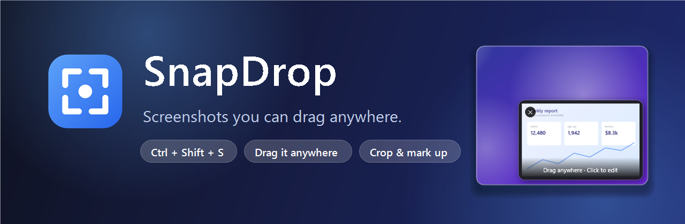
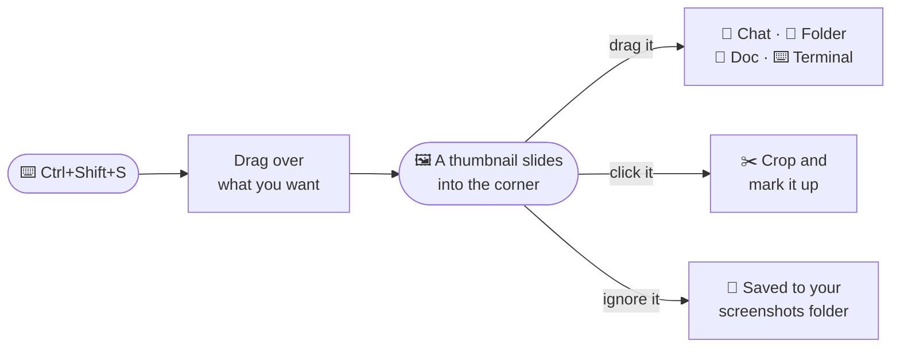
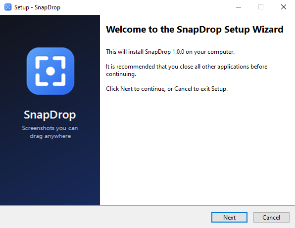
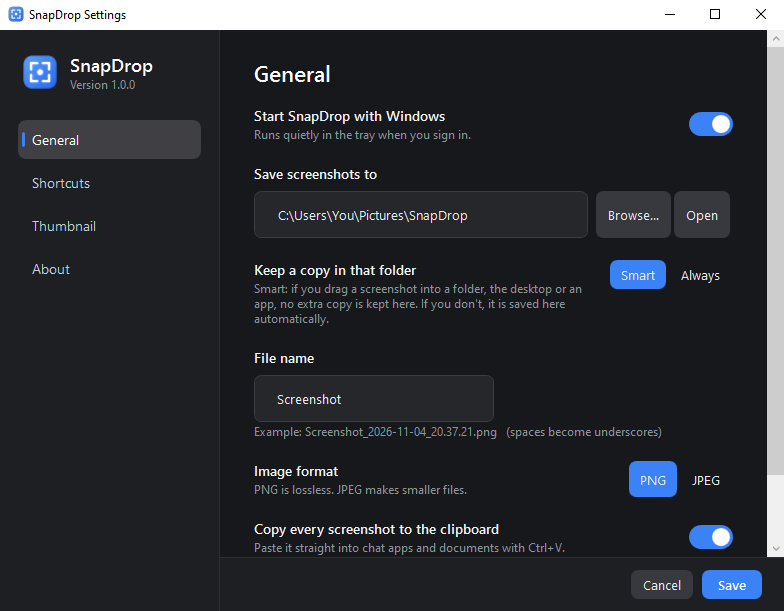
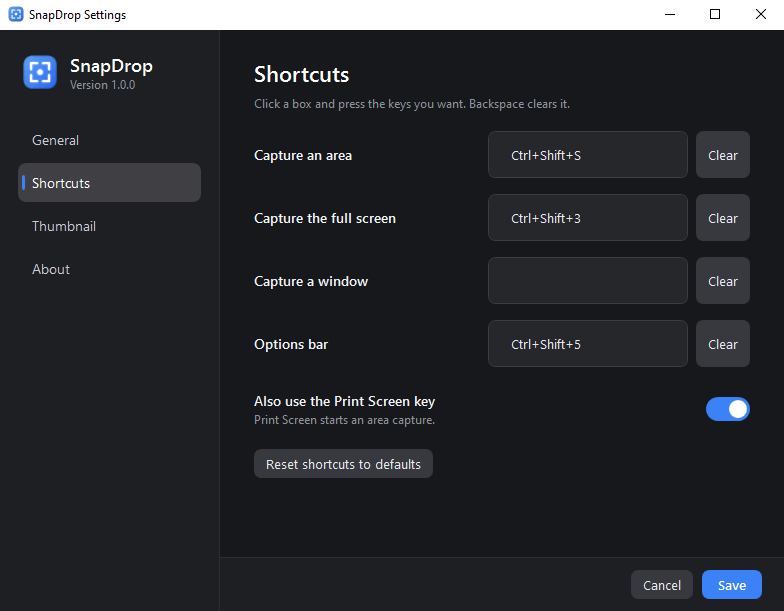
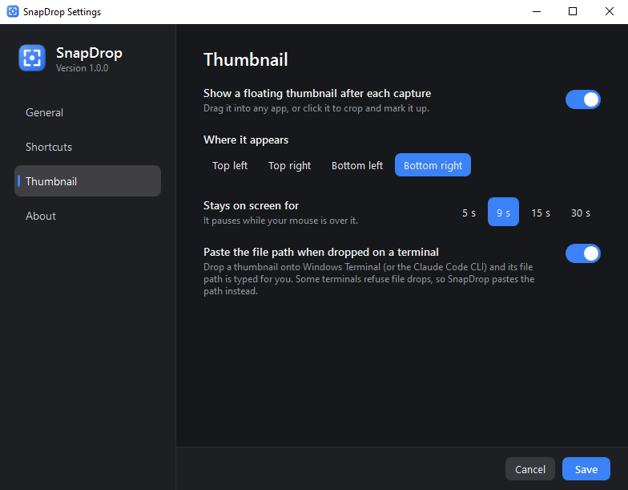

<p align="center">
  
</p>

<p align="center">
  
  
  
  
</p>

<p align="center">
  <a href="#-install">Install</a> ·
  <a href="#-how-it-feels">How it feels</a> ·
  <a href="#-shortcuts">Shortcuts</a> ·
  <a href="#-settings">Settings</a> ·
  <a href="#-build-it-yourself">Build it</a> ·
  <a href="#-help-wanted">Help wanted</a>
</p>

---

## 👋 Why this exists

On a Mac, you press a shortcut, a little preview slides into the corner of your screen, and you **drag it straight into whatever you're writing**. No file dialogs. No "where did I save that?". No clutter on the desktop.

On Windows I kept doing the same dance: capture, save, open a folder, find the file, drag it, then delete it later. So I built the thing I missed.

**SnapDrop** is a small tray app that gives Windows that same flow, plus a quick crop-and-mark-up editor, because most screenshots need a red arrow before they're useful.

## ✨ How it feels



<table>
  <tr>
    <td width="52%" valign="top">
      <h3>Drag it. That's the whole trick.</h3>
      Drop the thumbnail into Slack, Discord, WhatsApp Web, Word, Photoshop, a folder, the desktop, an email... Whatever accepts a file accepts it.
      <br><br>
      <b>Drop it on a terminal</b> and the file's path is typed for you. Handy for AI coding tools like Claude Code, or any CLI that wants an image path.
    </td>
    <td width="48%" align="center">
      
    </td>
  </tr>
</table>

### ✂️ A tiny editor that stays out of your way

Click the thumbnail to crop it and add the usual suspects: **arrow, box, text, highlighter, pen** and a **pixelate** tool for hiding passwords and faces. Everything is undoable, and there's a **⠿ Drag out** button so you can drag the edited image straight out of the editor too.

<p align="center">
  
</p>

### 🧹 It doesn't litter

This was the one thing I really didn't want to get wrong. By default SnapDrop is *smart* about where a screenshot ends up:

| What you do | Where the file ends up |
|---|---|
| Drag it into a folder, your desktop, a chat or a terminal | **There.** Nothing extra is kept in your screenshots folder. |
| Ignore it | It's saved to `Pictures\SnapDrop` when the thumbnail goes away. |
| Hit **Delete** on its right-click menu | Gone. |

If you'd rather have the classic "always save everything" behaviour, there's a switch for it in Settings.

### Also in the box

- 🖥️ Capture an **area**, a **window** (press <kbd>Space</kbd> while selecting) or the **full screen**
- ⏱️ Timers (3, 5 or 10 seconds) with a countdown
- 📋 Every shot is also copied to the clipboard, so <kbd>Ctrl</kbd>+<kbd>V</kbd> just works
- 🖥️🖥️ Multiple monitors and high-DPI screens
- 🪶 Tiny: the app is about 400 KB and idles in the tray

## 📥 Install

1. Grab **`SnapDrop-Setup-x.y.z.exe`** from the [**Releases**](../../releases) page.
2. Run it. It installs in a few seconds and needs no admin rights on a normal PC.
3. SnapDrop appears in your tray. Press <kbd>Ctrl</kbd>+<kbd>Shift</kbd>+<kbd>S</kbd> and go.

<p align="center">
  
</p>

> **Heads-up:** the installer isn't code-signed yet (certificates cost money), so Windows SmartScreen may say *"Windows protected your PC"*. Click **More info → Run anyway**. The source is right here if you'd like to check it, or build it yourself below.

SnapDrop needs the **.NET 10 Desktop Runtime**. If you don't have it, the installer offers to download it for you.

## 🔑 Shortcuts

Every one of these can be changed in **Settings → Shortcuts**.

| Keys | What it does |
|---|---|
| <kbd>Ctrl</kbd> <kbd>Shift</kbd> <kbd>S</kbd> | Capture an area. Press <kbd>Space</kbd> to pick a window instead, <kbd>Esc</kbd> to cancel |
| <kbd>Ctrl</kbd> <kbd>Shift</kbd> <kbd>3</kbd> | Capture the whole screen (the monitor your mouse is on) |
| <kbd>Ctrl</kbd> <kbd>Shift</kbd> <kbd>5</kbd> | Options bar: screen, window, selection, and a timer |
| <kbd>Print Screen</kbd> | Same as capture an area (optional) |

## 🔧 Settings

Right-click the tray icon → **Settings…** (or just launch SnapDrop again).

<p align="center">
  
  
  
</p>

- **General**: start with Windows, where screenshots go, file name, PNG or JPEG, clipboard, capture delay
- **Shortcuts**: click a box, press the keys you want. SnapDrop tells you if another app already owns them
- **Thumbnail**: which corner it appears in, how long it stays, and the terminal trick

Settings live in `%APPDATA%\SnapDrop\settings.ini`, in plain text.

## 🧱 Build it yourself

You'll need the [.NET 10 SDK](https://dotnet.microsoft.com/download/dotnet/10.0). For the installer you'll also want [Inno Setup 6](https://jrsoftware.org/isinfo.php) (`winget install JRSoftware.InnoSetup`).

```powershell
git clone https://github.com/PhoenixGoDdev/snapdrop
cd snapdrop
powershell -ExecutionPolicy Bypass -File scripts\build.ps1
```

You'll get `artifacts\publish\SnapDrop.exe` and `artifacts\SnapDrop-Setup-<version>.exe`. Handy flags: `-SkipInstaller`, `-Version 1.2.0`.

<details>
<summary><b>Project layout and developer switches</b></summary>

```
src/SnapDrop/   the app (C#, WPF, plus a sliver of WinForms for the tray icon)
installer/      Inno Setup script and wizard artwork
assets/         icon, logo, banner
docs/img/       the screenshots above
tools/          make-assets.ps1 / make-banner.ps1 regenerate the artwork
scripts/        build.ps1
```

Run from source with `dotnet run --project src\SnapDrop`. Switches: `--settings`, `--bar`, `--capture screen|region|window`, `--edit <file>`, `--thumb <file>`.

The code map is in [CONTRIBUTING.md](CONTRIBUTING.md).
</details>

## 🧯 When something's off

<details>
<summary><b>"Your Windows doesn't fully support CET" when starting a .NET 10 app</b></summary>

Some Windows 10 builds don't fully support CET (hardware shadow stacks), and .NET 10 turns it on by default, so apps refuse to start. SnapDrop already opts out (`<CETCompat>false</CETCompat>`). If you build other .NET 10 apps, add that line to their `.csproj`. Installing the latest Windows updates fixes it for good.
</details>

<details>
<summary><b>A shortcut doesn't do anything</b></summary>

Another app probably owns it (<kbd>Ctrl</kbd>+<kbd>Shift</kbd>+<kbd>S</kbd> is "Save As" in a lot of programs). Settings shows which shortcut failed. Pick different keys.
</details>

<details>
<summary><b>Dropping on Windows Terminal does nothing</b></summary>

Windows Terminal can refuse file drops when it runs as administrator. SnapDrop notices and pastes the file path for you instead. It's on by default under **Settings → Thumbnail**.
</details>

<details>
<summary><b>Something crashed</b></summary>

SnapDrop writes errors to `%APPDATA%\SnapDrop\error.log`. Please attach it to an [issue](../../issues).
</details>

## 🙋 Help wanted

SnapDrop is small on purpose, but there's plenty of room to make it better. Things I'd love a hand with:

- [ ] Code signing, so the installer stops tripping SmartScreen
- [ ] Scrolling capture for long pages
- [ ] Screen recording / GIF capture
- [ ] ARM64 build
- [ ] Translations
- [ ] Auto-update

Bug reports are gold too. Tell me your Windows version, what you expected and what happened. Pull requests are very welcome; [CONTRIBUTING.md](CONTRIBUTING.md) explains how the code fits together.

## 📄 License

[MIT](LICENSE). Use it, change it, ship it.

<p align="center"><sub>If SnapDrop saved you a few clicks, a ⭐ on the repo makes my day.</sub></p>
